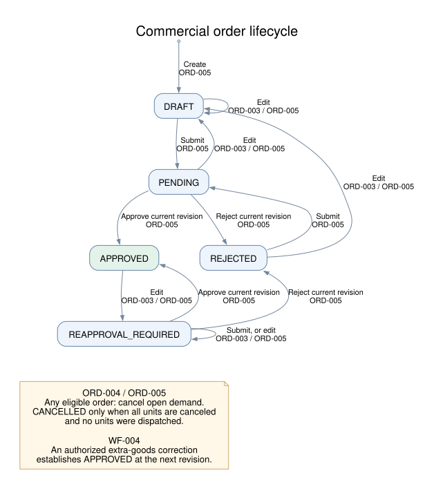
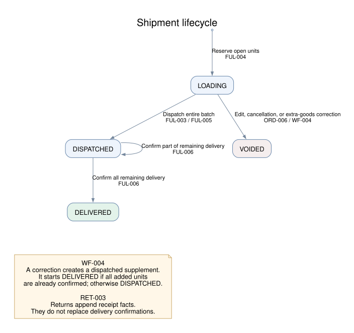
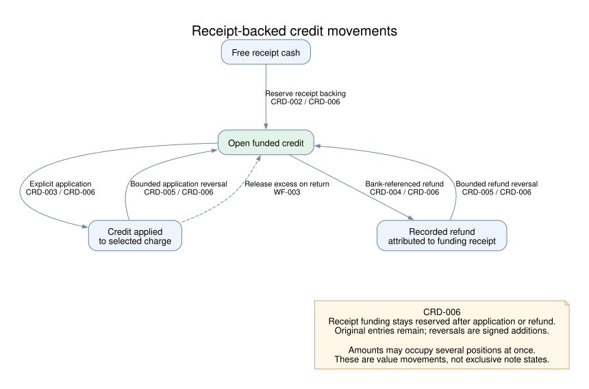
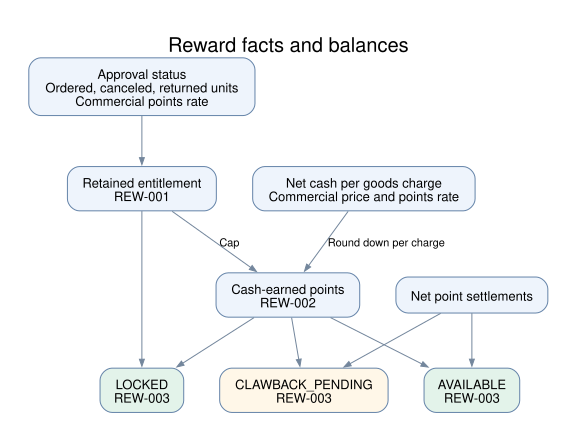
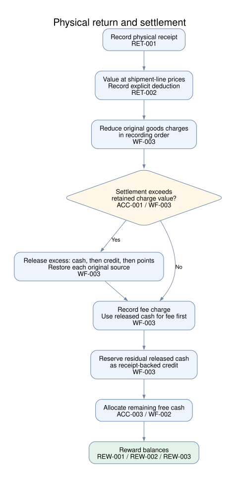
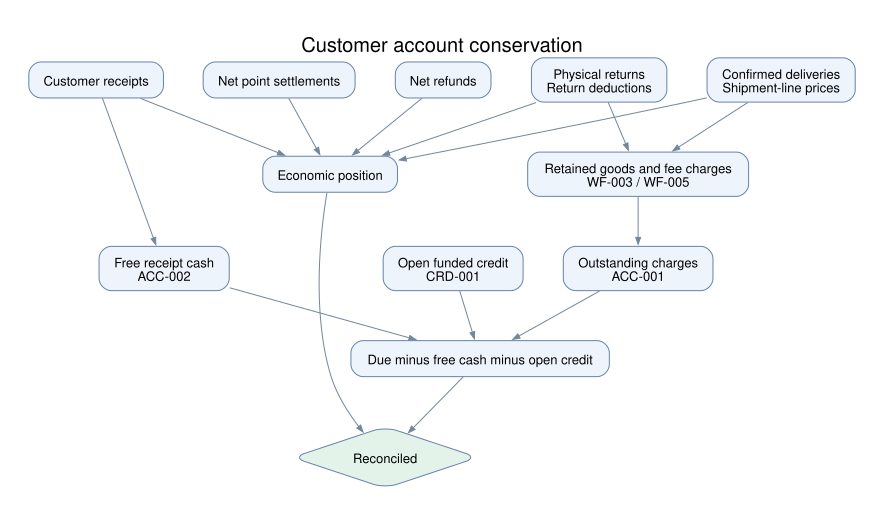

# Canonical business rules

Operating conventions **2026-10-26.1**. This specification defines the business facts for each domain module, followed by policies that connect modules. Rule identifiers are local to this edition; the operating conventions are unchanged.

Invariants hold after a completed business operation. Policies select permitted business outcomes. Transitions introduce facts or change business state. Diagrams illustrate the cited rules without adding policies.

Roles and action ownership are defined in [Business terms](business_terms.md#roles-and-actions). Authentication, request validation, retries, versions, and transaction mechanics belong to the [API reference](../api.md). Supporting modules are described in the [module index](../../server/src/README.md); they do not introduce separate commercial policies here.

## Notation

Money is in integer INR paise; quantities and points are integers. A prime denotes the resulting value. An operation quantity or amount is positive unless its rule explicitly permits zero. All sums of postings are signed, including reversals. Recording order means the order in which facts were recorded.

| Symbol                    | Business fact                                                                                               |
| ------------------------- | ----------------------------------------------------------------------------------------------------------- |
| $l,h,j,i,n$               | Commercial line, shipment line, charge, receipt, credit note.                                               |
| $Q_l,C_l,S_l,D_l,R_l,L_l$ | Ordered, canceled, dispatched, gross delivered, returned, and currently loading units of a commercial line. |
| $s_h,d_h,r_h$             | Dispatched, gross delivered, and returned units of a shipment line.                                         |
| $p_l,\rho_l,p_h$          | Agreed commercial price, commercial points per unit, and shipment-line price.                               |
| $v_j,c_j,k_j,z_j,b_j$     | Retained charge value, cash applied, credit applied, points applied, and outstanding amount.                |
| $m_i,a_i,f_i,u_i$         | Receipt amount, net cash allocated, credit funding reserved, and free cash.                                 |
| $I_n,K_n,F_n,O_n$         | Issued credit, net applications, net refunds, and open credit.                                              |

Commercial physical totals sum their shipment-line facts. Loading counts only batches still `LOADING`; voided batches do not reserve demand. Retained charge value is the original charge plus its signed adjustments. Receipt funding is the sum of its reservations across credit notes.

## Module specifications

### Customers

#### Invariants

**CUS-001. Account ownership.** Each order, receipt, credit note, and reward balance belongs to one customer. A settlement or funding link must connect records of that same customer.

**CUS-002. Account identity.** Customer codes are unique across customer accounts.

#### Transitions

**CUS-003. Identity change.** Creating a customer establishes an account identity. Changing its name or code retains that identity and its existing business records.

### Catalog

#### Invariants

**CAT-001. Product identity and terms.** SKU codes are unique. Each SKU has a positive catalog price and a positive points-per-unit rate.

#### Domain policies

**CAT-002. Commercial snapshot.** An ordinary new or edited commercial revision uses the supplied agreed price and the SKU's current points rate. Retained SKUs retain their commercial line identity. Historical documents retain their recorded terms. Additional dispatched goods use **WF-004** instead.

### Orders

#### Invariants

**ORD-001. Demand partition.** Each commercial revision contains at most one line per SKU. For each current commercial line, open demand $U_l$ satisfies:

$$
Q_l=C_l+S_l+U_l,\qquad C_l,S_l,U_l\geq0,\qquad 0\leq L_l\leq U_l.
$$

**ORD-002. Approval scope.** Commercial approval belongs to one exact revision. An order in `APPROVED` has an approval for its current revision.

#### Domain policies

**ORD-003. Ordinary edit boundary.** An ordinary edit is permitted only before any dispatch or cancellation and while the order is not `CANCELLED`.

**ORD-004. Cancellation scope.** Cancel selected unshipped demand, or all open demand when no selection is supplied. At least one unit must be canceled. A reason is required.

$$
0\leq q_l\leq U_l,\qquad \sum_l q_l>0.
$$

#### Transitions

**ORD-005. Commercial lifecycle.** Creation establishes revision 1. Editing appends a revision; review decisions apply to the current revision only. Rejection and editing require a reason.

| Operation | Starting condition                                      | Result                                                                                                         |
| --------- | ------------------------------------------------------- | -------------------------------------------------------------------------------------------------------------- |
| Create    | New order                                               | `DRAFT`.                                                                                                       |
| Edit      | ORD-003; previously `APPROVED` or `REAPPROVAL_REQUIRED` | Next revision; `REAPPROVAL_REQUIRED`.                                                                          |
| Edit      | ORD-003; any other permitted status                     | Next revision; `DRAFT`.                                                                                        |
| Submit    | `DRAFT` or `REJECTED`                                   | `PENDING`.                                                                                                     |
| Submit    | `REAPPROVAL_REQUIRED`                                   | Remain `REAPPROVAL_REQUIRED`.                                                                                  |
| Approve   | `PENDING` or `REAPPROVAL_REQUIRED`                      | Record approval; `APPROVED`.                                                                                   |
| Reject    | `PENDING` or `REAPPROVAL_REQUIRED`                      | Record rejection; `REJECTED`.                                                                                  |
| Cancel    | ORD-004                                                 | Append cancellations, $C'_l=C_l+q_l$. Set `CANCELLED` only if all units are canceled and none were dispatched. |

**ORD-006. Loading withdrawal.** An ordinary edit or effective cancellation voids **all** loading batches of the order.

### Fulfillment

#### Invariants

**FUL-001. Physical quantity bounds.** Apply these bounds separately to each shipment line:

$$
0\leq r_h\leq d_h\leq s_h.
$$

**FUL-002. Shipment authority.** Every nonvoided shipment uses an approved commercial revision. A loading batch uses the current revision.

#### Domain policies

**FUL-003. Loading and dispatch gate.** Loading and dispatch require the order to be `APPROVED` for the current revision. Dispatch also requires the loading document to name that revision.

#### Transitions

**FUL-004. Loading.** Create a `LOADING` batch that reserves selected open units. For each selected commercial line:

$$
0<q_l\leq U_l-L_l,\qquad L'_l=L_l+q_l.
$$

**FUL-005. Dispatch.** Dispatch a whole `LOADING` batch. Its loaded units become dispatched units, its reservation ends, and its status becomes `DISPATCHED`.

**FUL-006. Delivery.** Confirm additional quantities only on a `DISPATCHED` batch. Retain every confirmation. Set the batch to `DELIVERED` exactly when all its dispatched units have been confirmed.

$$
0<q_h\leq s_h-d_h,\qquad d'_h=d_h+q_h.
$$

### Returns

#### Domain policies

**RET-001. Return source.** A physical return identifies delivered shipment lines and a reason. It is recorded when goods are received back.

$$
0<q_h\leq d_h-r_h.
$$

**RET-002. Return valuation.** Value returned goods at their shipment-line price. The explicitly chosen deduction $\phi$ can be zero and cannot exceed the gross return value $g$.

$$
g=\sum_h q_hp_h,\qquad 0\leq\phi\leq g.
$$

#### Transitions

**RET-003. Physical receipt.** Append the return, increasing returned quantity without replacing the delivery fact:

$$
r'_h=r_h+q_h.
$$

Financial settlement of that return is defined once in **WF-003**.

### Accounts

#### Invariants

**ACC-001. Charge capacity.** For each charge, settlements and the remaining obligation are nonnegative:

$$
v_j,c_j,k_j,z_j\geq0,\qquad b_j=v_j-c_j-k_j-z_j\geq0.
$$

**ACC-002. Receipt capacity.** Receipt value is either allocated, reserved as credit funding, or free:

$$
a_i,f_i\geq0,\qquad u_i=m_i-a_i-f_i\geq0.
$$

#### Domain policies

**ACC-003. Cash priority.** Allocate free cash across the customer's outstanding charges in creation-time order, breaking ties by recording order. Visit receipts in that same ordering. Each allocation takes:

$$
x=\min(u_i,b_j).
$$

#### Transitions

**ACC-004. Payment receipt.** Record a customer payment with its receipt reference, then apply **WF-002**. A receipt names the customer rather than an order.

**ACC-005. Cash allocation.** For a positive allocation $x$, append the receipt-to-charge attribution:

$$
a'_i=a_i+x,\qquad c'_j=c_j+x.
$$

### Credits

#### Invariants

**CRD-001. Funded credit capacity.** Let $f_{ni}$ be the amount of receipt $i$ reserved for note $n$. Every credit note is fully receipt-backed, and applications and refunds remain within its issued value:

$$
I_n=\sum_i f_{ni},\qquad K_n,F_n\geq0,\qquad O_n=I_n-K_n-F_n\geq0.
$$

Net refunds attributed to a note/receipt pair cannot exceed that pair's funding.

#### Domain policies

**CRD-002. Explicit issue.** Reserve only free cash. Choose receipts in recording order until the requested issue amount is funded.

$$
0<x\leq\sum_i u_i.
$$

**CRD-003. Application.** Apply credit explicitly to a selected charge:

$$
0<x\leq\min(O_n,b_j).
$$

**CRD-004. Refund.** Record a refund against open credit, with a bank reference. Split it across the note's funding receipts in funding-record order, within each receipt's unrefunded funding capacity.

$$
0<x\leq O_n.
$$

**CRD-005. Reversal limits.** A reversal names a positive original entry and a reason; refund reversal also records a bank reference. Let $w_e$ be that entry's amount less its linked reversals, and $K_{nj}$ the net credit still applied between its note and charge:

$$
\begin{aligned}
\text{Application reversal: }&0<x\leq\min(w_e,K_{nj}),\\
\text{Refund reversal: }&0<x\leq w_e.
\end{aligned}
$$

#### Transitions

**CRD-006. Credit movements.** Append the appropriate fact. Issuance requires a reason. Application and refund leave the receipt funding reserved; reversal appends a negative entry linked to the original. A split refund is reversed per original entry.

| Operation           | Appended fact                                                 |
| ------------------- | ------------------------------------------------------------- |
| Issue               | Note of $x$, with receipt funding totaling $x$.               |
| Apply               | Application of $+x$ from note to charge.                      |
| Refund              | Refund entries totaling $+x$, attributed to funding receipts. |
| Reverse application | Application of $-x$ to the same note and charge.              |
| Reverse refund      | Refund of $-x$ to the same note and funding receipt.          |

### Rewards

#### Domain policies

**REW-001. Retained entitlement.** Commercial approval establishes entitlement at the commercial line's recorded points rate:

$$
E_l=\begin{cases}
(Q_l-C_l-R_l)\rho_l,&\text{order status is APPROVED},\\
0,&\text{otherwise}.
\end{cases}
$$

**REW-002. Cash qualification.** Earn points from net cash applied to goods charges, using the current commercial line's recorded price and points rate. Round down **per charge**, then cap at retained entitlement:

$$
e_l=\min\left(E_l,\sum_{j\in\operatorname{goods}(l)}
\left\lfloor\frac{c_j\rho_l}{p_l}\right\rfloor\right).
$$

**REW-003. Bucket policy.** Let $Z$ be the customer's net redeemed points. The required reward balances are:

$$
\begin{aligned}
\mathrm{Locked}&=\sum_l(E_l-e_l),\\
\mathrm{Available}&=\max\left(0,\sum_l e_l-Z\right),\\
\mathrm{ClawbackPending}&=\max\left(0,Z-\sum_l e_l\right).
\end{aligned}
$$

**REW-004. Redemption.** One point settles one paise of a selected charge. Redemption is permitted only with no pending clawback:

$$
\mathrm{ClawbackPending}=0,\qquad
0<x\leq\min(\mathrm{Available},b_j).
$$

#### Transitions

**REW-005. Reward postings.** Post signed differences to bring balances to **REW-001** through **REW-003** when their input facts change. Redemption appends a point settlement and increases $Z$; releasing a point settlement appends its negative and decreases $Z$.

## Intermodule and workflow logic

### Invariants

**WF-001. Business history.** Preserve commercial revisions, confirmed dispatches and deliveries, returns, receipts, and posted financial/reward entries. Changes to posted value use linked additions or compensating entries.

### Domain policies

**WF-002. Cash allocation occasions.** Apply **ACC-003** after payment receipt, delivery confirmation, additional-goods correction, and completed return settlement, or on explicit allocation. Other operations do not trigger cash allocation.

### Transitions

**WF-003. Return settlement.** For each returned shipment line, reduce its goods charges in recording order by the gross returned value. Append negative adjustments to the original charges. For each reduced charge, release only settlement exceeding its retained value, taking cash first, then credit, then points. Within cash or credit, visit source groups in reverse order of their first allocation/application. Restore each released amount to its original receipt, credit note, or point balance.

Record the deduction as a separate fee charge. Apply released cash to that fee first, in the order the receipt sources were first encountered during release. Reserve any remaining released cash as a new receipt-backed credit note. Then apply **WF-002**.

**WF-004. Additional dispatched goods.** An existing dispatch, a reason, supporting evidence, and an authorization reference are required. Identify whether the additional units traveled in a named existing dispatch of this order or a separate dispatch. A separate dispatch requires its actual time, no later than the present. Until the physical dispatch is identified, no correction is recorded.

For each added SKU, record positive additional units $q$ and already delivered units $d$, where $0\leq d\leq q$. Append a commercial revision with $Q'_l=Q_l+q_l$ for retained SKUs and new lines for added SKUs. Retained SKUs keep their agreed price and commercial points rate; new SKUs use the supplied price and current catalog rate. Record authorization as approval of the new revision and set the order to `APPROVED`.

Void all loading batches. Append a dispatched supplement, linked to the original dispatch when applicable, retaining its dispatch time; otherwise use the separate dispatch's actual time. Supplement lines use the current catalog points rate. Record the supplied delivered units through **WF-005**; later confirmations follow **FUL-006**.

**WF-005. Delivery recognition.** Each delivery confirmation creates exactly one goods charge at the shipment-line price:

$$
\operatorname{value}(\operatorname{charge}(e))=q_ep_h,
\qquad \#\operatorname{charges}(e)=1.
$$

Then apply **WF-002**. Loading and dispatch introduce only their physical facts under **FUL-004** and **FUL-005**.

### Account invariant

**WF-006. Customer account conservation.** For each customer, the economic position and the open balances must agree. Let $G$ be gross confirmed delivery value, $V$ gross returned value, $\Phi$ return deductions, $M$ receipts, and $F$ net recorded refunds:

$$
G-V+\Phi-M+F-Z
=\sum_j b_j-\sum_i u_i-\sum_n O_n.
$$

Positive value means the customer owes money; negative value means value is owed to the customer.

## Related

- [Business guide](README.md)
- [Business terms](business_terms.md)
- [Business reference](../business-terms.md)
- [API reference](../api.md)
- [Backend module responsibilities](../../server/src/README.md)
- [Verification](../verification.md)
